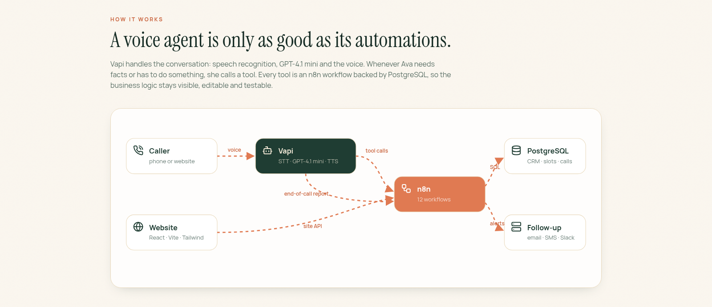
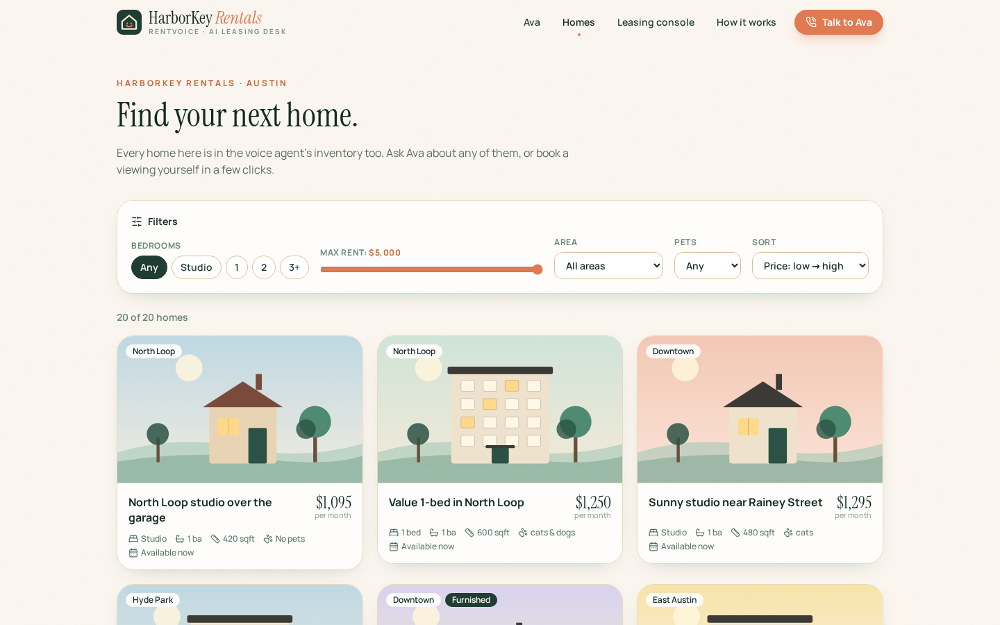
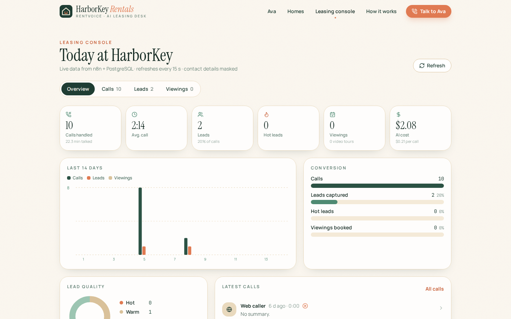
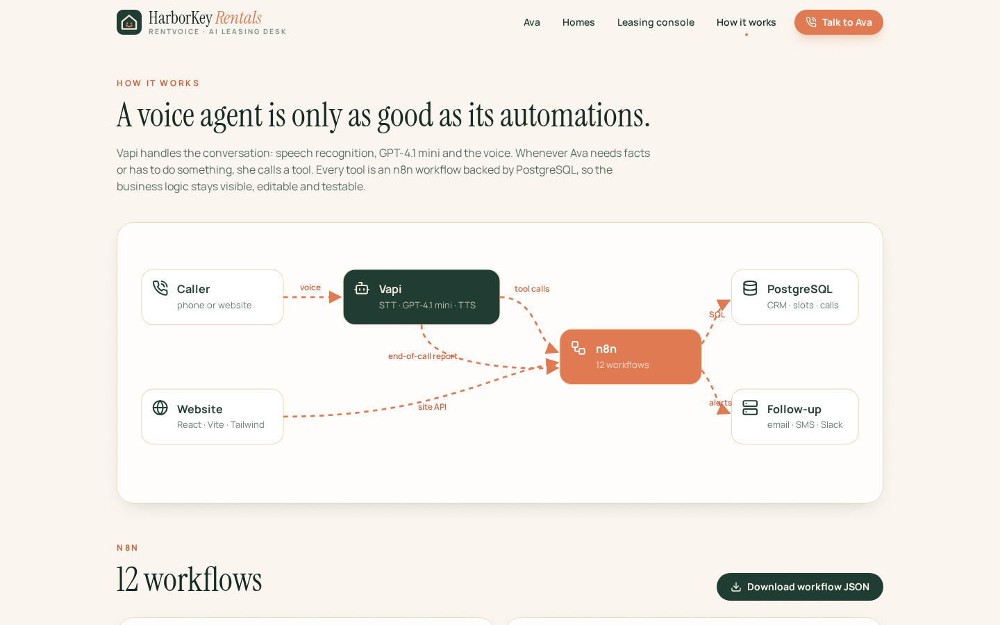
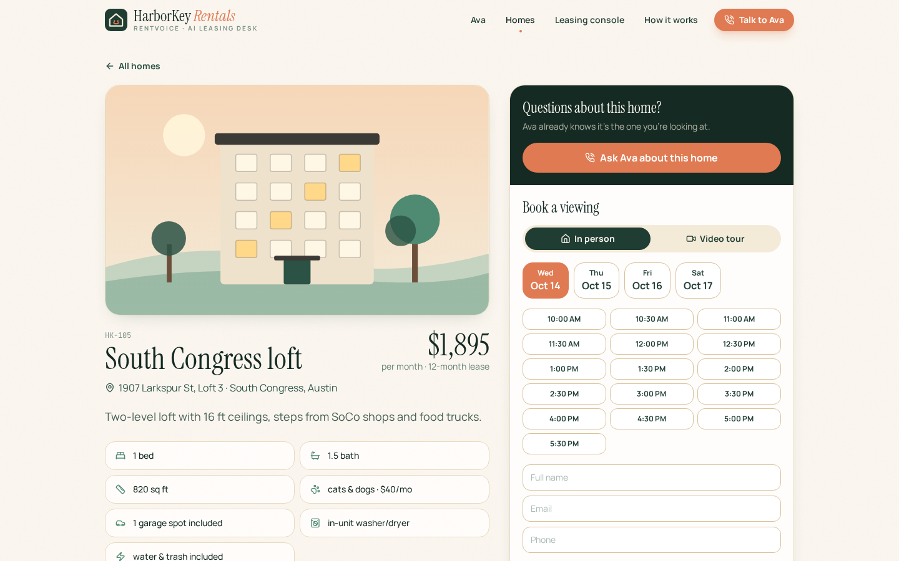
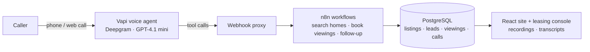

# RentVoice

**Voice AI & automation**

An AI voice agent for a rental company. Ava answers renter calls by phone or from a button on the website, searches the listings, checks whether the caller fits, books a viewing and saves the lead. Every call lands in a dashboard.

[**Open the live demo**](https://rentvoice.twinstackstudio.com) · [**Work with TwinStack Studio**](https://twinstackstudio.com/contact)

> **Note:** HarborKey Rentals and its listings are fictional; the demo is not connected to a real property manager. Speech, the language model and the voice run on Vapi's cloud, so each call has a small running cost.

## What it does

- Vapi runs the conversation: speech-to-text, GPT-4.1 mini and a natural voice
- Every action Ava takes is an n8n workflow, so the business logic stays visible and easy to change
- Searches listings, answers questions about a property, checks open viewing slots and books one
- Qualifies each caller and saves the lead to PostgreSQL
- Each call is stored with its recording, transcript, AI summary, extracted details and cost
- Talk to Ava straight from the browser, no phone needed

## Screenshots

| Homes | Leasing console |
| --- | --- |
|  |  |

| How it works | Home page |
| --- | --- |
|  |  |

## Technology

| Layer | Stack |
| --- | --- |
| Voice AI | Vapi, Deepgram, GPT-4.1 mini |
| Automation | n8n, Webhooks |
| Backend | PostgreSQL, Python |
| Frontend | React, Vite, Tailwind CSS |

## Architecture

## Source code

This is the public showcase. The source code is kept in a private repository. Try the live demo above, and [contact TwinStack Studio](https://twinstackstudio.com/contact) for a walkthrough or a similar project.

## Built by TwinStack Studio

TwinStack Studio builds full-stack websites, web applications, mobile apps,
dashboards, portals, automation, and AI-powered products.

[GitHub](https://github.com/twinstack-studio) ·
[Website](https://twinstackstudio.com) ·
[Email](mailto:hello@twinstackstudio.com)

© 2026 TwinStack Studio. All rights reserved. See [LICENSE](./LICENSE).
